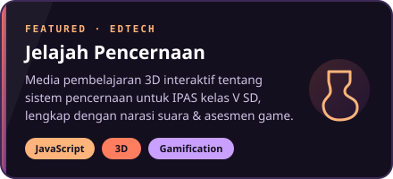
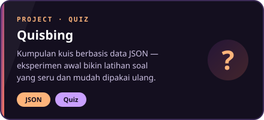

  

  

  
  
  
  

 

  

 

<h2 align="center">🚀 Featured Projects</h2>

  
  &nbsp;
  

 

<h2 align="center">🛠️ Toolbox</h2>

  

  
  
  
  

 

<h2 align="center">🔥 Consistency</h2>

  

 

<h2 align="center">🤝 Let's Connect</h2>

  
  

  

